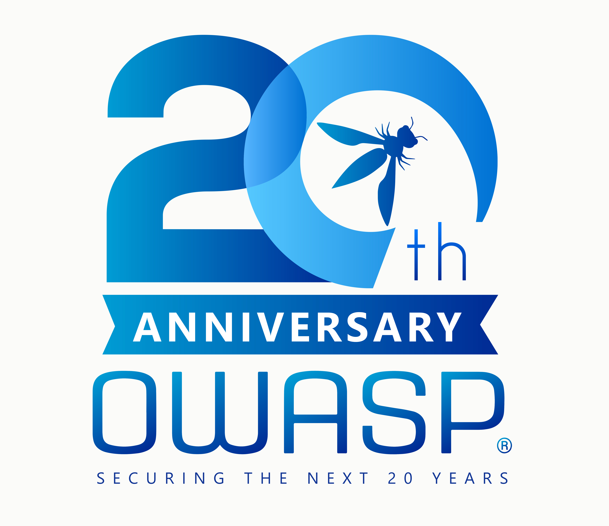

### Code Repository
* [GitHub](https://github.com/OWASP/owasp-java-encoder/)

## Downloads
* [encoder-1.6.0.jar](https://central.sonatype.com/artifact/org.owasp.encoder/encoder/1.6.0)
* [encoder-jakarta-jsp-1.6.0](https://central.sonatype.com/artifact/org.owasp.encoder/encoder-jakarta-jsp/1.6.0)
* [encoder-jsp-1.6.0](https://central.sonatype.com/artifact/org.owasp.encoder/encoder-jsp/1.6.0)

The ESAPI adapter is retired; see the [migration notice](https://github.com/OWASP/owasp-java-encoder/blob/main/docs/encoder-esapi-retirement.md).
